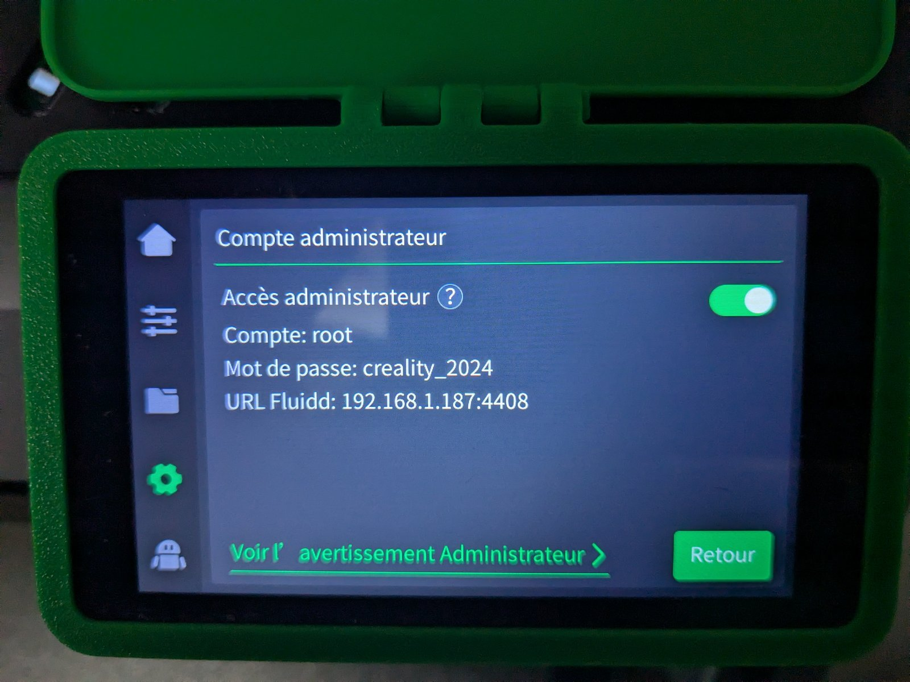
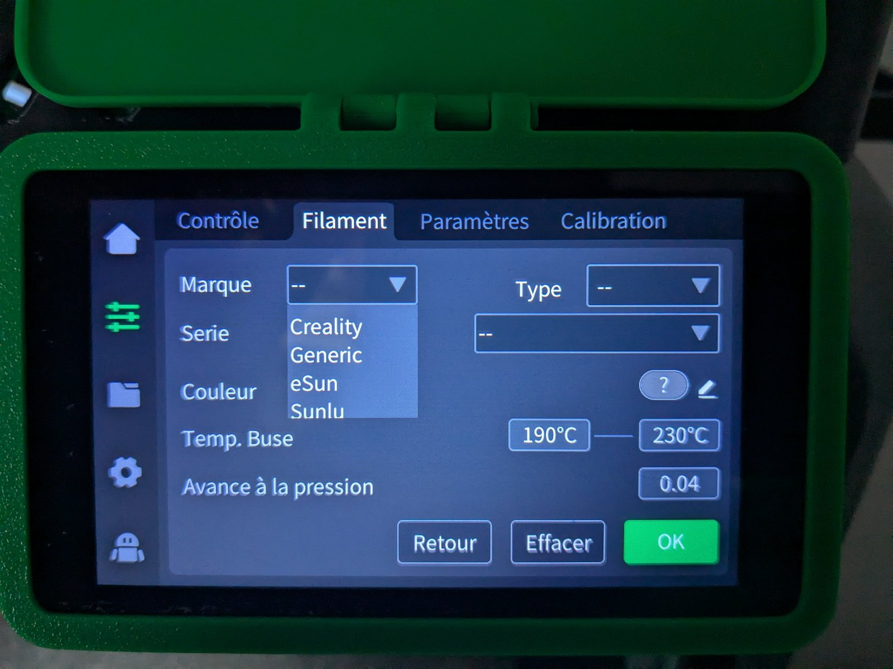
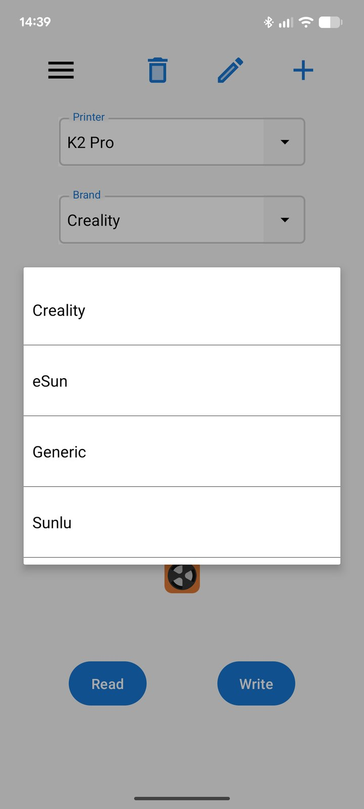
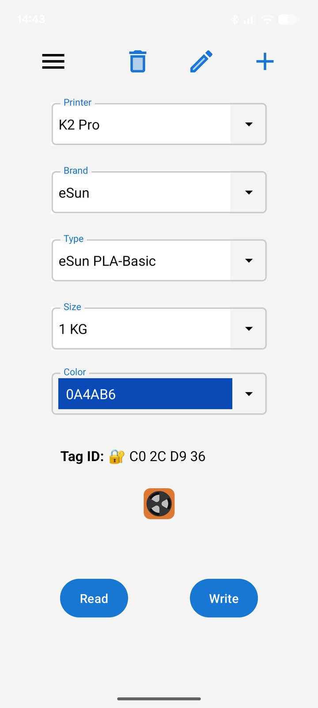
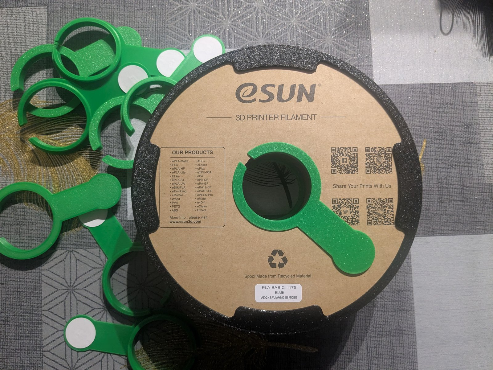
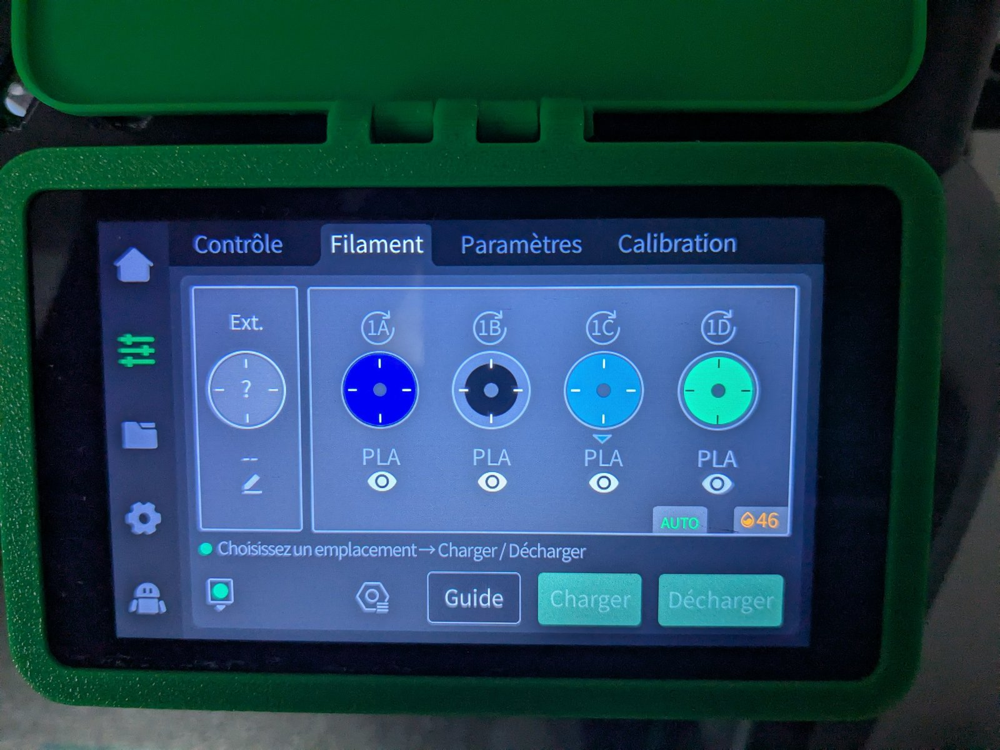
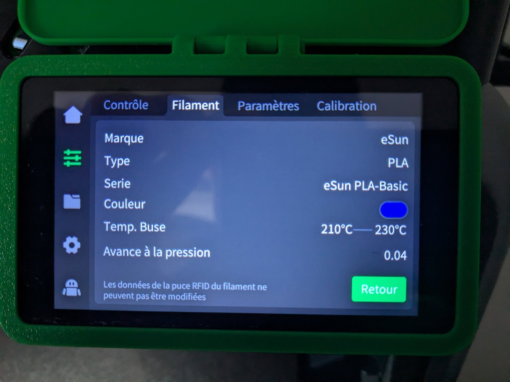

# 🧵 Creality K2 Pro / CFS : RFID personnalisé pour n'importe quelle bobine (+ synchro Spoolman / Home Assistant en option)

[English version](README.md)

Rends **n'importe quelle bobine de filament tierce** (eSun, Sunlu, Extrudr...) 100 % compatible avec le **CFS (Creality Filament System)** de la K2 Pro grâce au RFID, avec tes filaments affichés **par fabricant** dans le menu de l'imprimante. En **bonus optionnel**, garde **Spoolman** synchronisé automatiquement via Home Assistant.

> **Avertissement.** Projet communautaire, sans lien avec Creality. La partie RFID nécessite l'**accès root** à l'imprimante et la modification d'un fichier interne : cela peut annuler la garantie et une erreur peut casser ton menu de filaments. Sauvegarde toujours le fichier d'origine. À utiliser à tes risques.

| | Rôle | Nécessite |
|---|---|---|
| **Partie 1 : tags RFID** (guide principal) | Bobines tierces reconnues par le CFS, regroupées par fabricant | Accès root, téléphone NFC, puces RFID |
| **Partie 2 : synchro Spoolman / Home Assistant** (optionnelle) | Suit la consommation et assigne la bonne bobine Spoolman au slot du CFS | Home Assistant, Spoolman, SpoolmanSync. **Pas de root.** |

---

## Partie 1 : tags RFID pour n'importe quelle bobine

### Ce qu'il te faut
- **Imprimante :** Creality K2 Pro avec CFS, **accès root (SSH)**
- **Slicer :** Creality Print
- **Puces :** tags NFC M1 Classic 1K (13,56 MHz, UID sur 4 octets)
- **Téléphone :** Android avec NFC, application **CFS RFID** ([Google Play](https://play.google.com/store/apps/details?id=dngsoftware.spoolid&hl=fr))
- **Ordinateur :** pour la connexion SSH et la copie de fichiers (SCP/SFTP)

### Pourquoi modifier le catalogue de l'imprimante
Par défaut, la K2 Pro ne reconnaît pas les puces RFID tierces et classe toute bobine non-Creality en **Generic**. Le CFS identifie un filament grâce à un identifiant écrit sur la puce, recherché dans le catalogue interne de l'imprimante. Pour avoir tes marques (eSun, Sunlu...) dans le menu et sur les puces, tu les ajoutes à ce catalogue.

### Étape 1 : créer et exporter tes filaments
1. Dans Creality Print, crée tes filaments personnalisés (marque, type, températures...).
2. Exporte tes préréglages de filaments (un `.json` par filament).

### Étape 2 : modifier le catalogue de l'imprimante
1. **Active l'accès root** sur l'écran de l'imprimante : *Paramètres* > *Général* > *Compte administrateur* > *Accès administrateur*. L'imprimante affiche un message d'avertissement sur les risques du mode root ; lis-le attentivement, accepte, et elle affiche alors l'identifiant (`root`) et le mot de passe (`creality_2024`), identiques sur toutes les imprimantes. 
   Connecte-toi ensuite en SSH avec cet identifiant et ce mot de passe. Comme ils sont les mêmes pour tout le monde, ne rends jamais l'imprimante accessible depuis Internet tant que le mode root est activé.
2. **Sauvegarde** le catalogue, situé dans `/mnt/UDISK/creality/userdata/box/material_database.json`.
3. Modifie le fichier (voir [Structure du catalogue](#structure-du-catalogue)) pour ajouter tes filaments sous leur propre marque, à la main, avec l'[outil HTML](tools/add_filament.html) ou avec le [script Python](tools/add_filament.py).
4. Mets l'en-tête à jour : `result.count` et `result.version` (voir [Versionnement](#versionnement)).
5. Recopie le fichier au même emplacement via SCP/SFTP, puis redémarre les services ou l'imprimante.
6. Vérifie le menu de filaments de l'imprimante : tes filaments doivent apparaître regroupés par fabricant .

### Étape 3 : synchroniser le catalogue dans l'appli CFS RFID
1. Vérifie que le téléphone est sur le même réseau local que l'imprimante.
2. Ouvre **CFS RFID** et connecte-la à l'imprimante (adresse IP).
3. **Télécharge la base de données** de l'imprimante dans l'appli.
4. Tes marques et filaments sont maintenant sélectionnables .

### Étape 4 : écrire les tags
1. Dans l'appli, sélectionne l'imprimante (*K2 Pro*), la marque, le type (le modèle de filament), la taille de la bobine (par ex. *1 KG*) et la couleur.
2. Vérifie que le type et la couleur correspondent bien à ce que tu as défini dans le catalogue.
3. Plaque la puce M1 Classic 1K au dos du téléphone pour l'écrire. 

### Étape 5 : poser le tag sur la bobine


- **Bobines Creality (réutilisation) :** reprogrammation directe du tag d'origine.
- **Bobines tierces réutilisables :** colle un tag sur **chaque flanc** de la bobine, avec un gabarit de positionnement imprimé en 3D pour aligner la puce avec le lecteur du CFS ([gabarit de positionnement](3d-models/RFID_Positioning_Tool/)).
- **Bobines carton sur le support de bobine extérieur :** pose sur un flanc de la bobine un support simple qui accueille la puce ([RFID_Holder](3d-models/RFID_Holder/)).
- **Bobines jetables / carton (diamètre 55 mm, type eSun) :** utilise un support clipable qui accueille la puce ([Support_RFID_55mm](3d-models/Support_RFID_55mm/)).

Tous les modèles sont décrits dans [3d-models/](3d-models/).

### Étape 6 : mettre sa bobine dans le CFS
Après avoir chargé la bobine dans le CFS, celle-ci est reconnue automatiquement par l'imprimante.



### Structure du catalogue
`material_database.json` ressemble à ceci :
```
{ "code": 0, "msg": "ok", "reqId": "...",
  "result": { "version": "...", "count": N, "list": [ { "base": {...}, "kvParam": {...} }, ... ] } }
```
- `base` est ce qu'affichent le menu et l'appli : `id`, `brand`, `name`, `meterialType` (orthographe d'origine), `colors`, `rank`, `minTemp`, `maxTemp`, valeurs de séchage...
- `kvParam` contient les paramètres d'impression du préréglage du slicer (`filament_vendor`, `filament_type`, températures, ventilation, plateau...).

Quand un préréglage du slicer est synchronisé, l'imprimante l'ajoute avec `"brand": "Generic"` en **réutilisant l'identifiant générique** (`00001` pour le PLA, `00003` pour le PETG), avec un champ `userMaterial` qui pointe vers le fichier du préréglage. C'est pourquoi plusieurs entrées partagent le même `id`. **Conserve ces entrées.**

**Ajouter un filament sous sa propre marque :** ajoute une **nouvelle entrée** (copie une entrée générique du même matériau, par exemple `Generic PLA`, puis modifie) :

| Champ | Valeur |
|---|---|
| `base.id` | Un identifiant unique hors de la plage Creality, par ex. `90001`, `90002`... |
| `base.brand` | La marque affichée dans le menu (`eSun`, `Sunlu`) |
| `base.name` | Nom lisible, par ex. `eSun PLA-Basic` |
| `base.meterialType` | `PLA`, `PETG`... |
| `base.minTemp` / `maxTemp` | Issues de ton préréglage du slicer |
| `base.rank` | Ordre de tri (nous avons utilisé `3000`) |
| `kvParam.filament_vendor` | La même marque |
| `kvParam` températures, ventilation, plateau | Issus de ton préréglage du slicer |

Un exemple de bloc `base` est disponible dans [`docs/example-entry-base.json`](docs/example-entry-base.json).

### Utiliser l'outil HTML (le plus simple)
Pas besoin d'installer quoi que ce soit : ouvre [`tools/add_filament.html`](tools/add_filament.html) dans ton navigateur (double-clic sur le fichier).

1. **Glisse** ton `material_database.json` (récupéré sur l'imprimante) dans la première zone.
2. **Glisse** tes préréglages de filaments exportés depuis Creality Print dans la deuxième zone (tu peux en glisser plusieurs).
3. Clique sur **Ajouter les filaments** (ou sur *Aperçu seulement* pour voir ce qui serait fait).
4. Clique sur **Télécharger le nouveau material_database.json**, puis remplace le fichier sur l'imprimante (étape 5 de la procédure).

La page fonctionne **hors ligne** : tes fichiers ne sont envoyés nulle part et ton fichier d'origine n'est jamais modifié (garde quand même une sauvegarde). Elle applique exactement les mêmes règles que le script Python ci-dessous.

### Utiliser le script Python (option)
Si tu es à l'aise avec Python, tu peux utiliser [`tools/add_filament.py`](tools/add_filament.py) (Python 3, sans dépendance). **Lance-le sur ton ordinateur, sur une copie du catalogue récupérée de l'imprimante**, puis renvoie le résultat.

```
python add_filament.py material_database.json eSun_PLA-Basic.json Sunlu_PETG-Basic.json
python add_filament.py material_database.json mon_prereglage.json --dry-run
```

Pour chaque préréglage exporté, le script :
1. retrouve l'entrée générique correspondante grâce au champ `inherits` du préréglage ;
2. la copie, puis renseigne l'`id` (prochain identifiant libre à partir de `90001`), la marque (`filament_vendor`), le nom lisible, le `rank`, les températures min/max et la densité ;
3. applique les valeurs du préréglage sur `kvParam` (uniquement les clés déjà présentes dans le catalogue ; les autres sont signalées) ;
4. met à jour `result.count` et `result.version` (sans jamais diminuer la version actuelle) ;
5. **enregistre une sauvegarde horodatée** du fichier d'origine avant d'écrire.

Options utiles : `--dry-run` (n'écrit rien), `--out fichier.json` (écrit ailleurs), `--id` (identifiant imposé, pour un seul préréglage), `--replace` (remplace une entrée existante de même marque et même nom). Un filament déjà présent est ignoré sans `--replace`.

*Vérification :* appliqué à notre catalogue d'origine avec nos cinq préréglages, le script reproduit nos cinq entrées. Trois sont strictement identiques ; pour les deux PETG, la seule différence est que le script aligne la densité de `base` sur celle de `kvParam` (1,27 au lieu de 1,24).

### Versionnement
- `result.count` doit être égal au nouveau nombre d'entrées.
- `result.version` doit prendre une **valeur très élevée** pour que ton catalogue ne soit jamais jugé plus ancien qu'une autre version et écrasé. Nous avons utilisé `9876543210`. **La valeur doit être supérieure à celle d'origine** (dans notre fichier, l'originale ressemblait à un horodatage, `1790760956`) : un petit nombre comme `999999` ferait donc l'inverse de l'effet recherché.
- Il s'agit d'une pratique constatée, non documentée par Creality.

### Pièges
- Garde une copie de chaque version du catalogue avant modification.
- Vérifie que le JSON reste valide avant de le recopier.
- Dans nos exemples PETG, `density` dans `base` (1,24) diffère de `kvParam.filament_density` (1,27) : garde-les cohérents dans tes propres entrées (le script le fait automatiquement).

---

## Partie 2 (optionnelle) : synchro Spoolman / Home Assistant

Passe cette partie si tu n'utilises ni Home Assistant ni Spoolman. Elle ne demande **aucun accès root** et s'appuie sur les tags de la Partie 1.

### Ce qu'il te faut
Home Assistant avec les composants suivants (versions testées) :

| Composant | Version testée | Remarques |
|---|---|---|
| [ha_creality_ws](https://github.com/3dg1luk43/ha_creality_ws) | 0.9.10 | Intégration Home Assistant de l'imprimante |
| [Spoolman](https://github.com/Donkie/Spoolman) | 0.27.0 | Port 7912 par défaut |
| [SpoolmanSync](https://github.com/gibz104/SpoolmanSync) | 1.6.14 | Port 3000 par défaut |

### Fonctionnement
1. L'intégration expose un capteur par slot du CFS (`sensor.k2pro_creality_cfs_box_1_slot_1_filament`, ...) avec des attributs comme `vendor`, `type`, `color_hex`, `rfid`, `spool_key`, `selected`.
2. Deux automations SpoolmanSync suivent le slot actif et la longueur de filament consommée (cm), puis l'envoient à SpoolmanSync.
3. Une troisième automation **assigne la bobine Spoolman au slot** quand une puce est lue : elle cherche dans Spoolman les bobines non archivées du **même fabricant, matériau et couleur** que la puce. S'il y en a plusieurs, elle prend celle déjà entamée qui a le moins de filament restant, sinon la première.

### Règle de correspondance (importante)
Dans Spoolman :
- le **nom du fabricant** doit être identique à la marque écrite sur la puce (ex. `eSun`), sans tenir compte des majuscules ;
- le **matériau** doit être identique au type de filament (ex. `PLA`) ;
- le **code couleur hex** doit être identique à la couleur écrite sur la puce (sans `#`, majuscules ou minuscules sans importance).

### Installation
1. Installe et configure Spoolman et SpoolmanSync, puis ajoute ton imprimante dans SpoolmanSync.
2. Ajoute les blocs de [`homeassistant/configuration_spoolmansync.yaml`](homeassistant/configuration_spoolmansync.yaml) à ton `configuration.yaml`, en remplaçant `k2pro_creality` par le nom de ton imprimante et les IP d'exemple (`SPOOLMAN_IP`, `SPOOLMANSYNC_IP`) par les tiennes.
3. Mets le token du webhook dans `secrets.yaml` (voir [`homeassistant/secrets.example.yaml`](homeassistant/secrets.example.yaml)). **Ne publie jamais ton vrai token.**
4. Ajoute les trois automations de [`homeassistant/automations_spoolmansync.yaml`](homeassistant/automations_spoolmansync.yaml). Dans la dernière, renseigne `printer_ip` avec l'IP de ton imprimante.
5. Redémarre Home Assistant.
6. **Teste d'abord :** `dry_run` est à `true` par défaut, l'automation envoie alors seulement une notification indiquant la bobine qu'elle *assignerait*. Insère une bobine avec puce, vérifie la notification, puis passe `dry_run: false`.

### Bon à savoir
- **Index des slots :** SpoolmanSync compte les slots à partir de 0, donc le slot 1 du CFS correspond à l'index 0. L'automation gère ce décalage (`slot_num - 1`).
- **Bobine externe :** la clé de plateau `cfs_external_filament` est à vérifier sur ton installation.
- Si aucune bobine ne correspond, une notification persistante te demande de l'assigner à la main dans SpoolmanSync.

---

## Crédits et licence
Ce projet s'appuie sur le travail d'autres personnes :
- l'application [CFS RFID](https://play.google.com/store/apps/details?id=dngsoftware.spoolid) (dngsoftware) pour écrire les tags ;
- [SpoolmanSync](https://github.com/gibz104/SpoolmanSync), [Spoolman](https://github.com/Donkie/Spoolman) et [ha_creality_ws](https://github.com/3dg1luk43/ha_creality_ws) pour la partie Home Assistant.

**Licences :** configuration Home Assistant et outils (`homeassistant/`, `tools/`) sous licence [MIT](LICENSES/MIT.txt) ; modèles 3D et documentation (`3d-models/`, `docs/`) sous licence [CC BY-SA 4.0](LICENSES/CC-BY-SA-4.0.txt). Détails dans [LICENSE](LICENSE).

Voir aussi [CONTRIBUTING.md](CONTRIBUTING.md).
