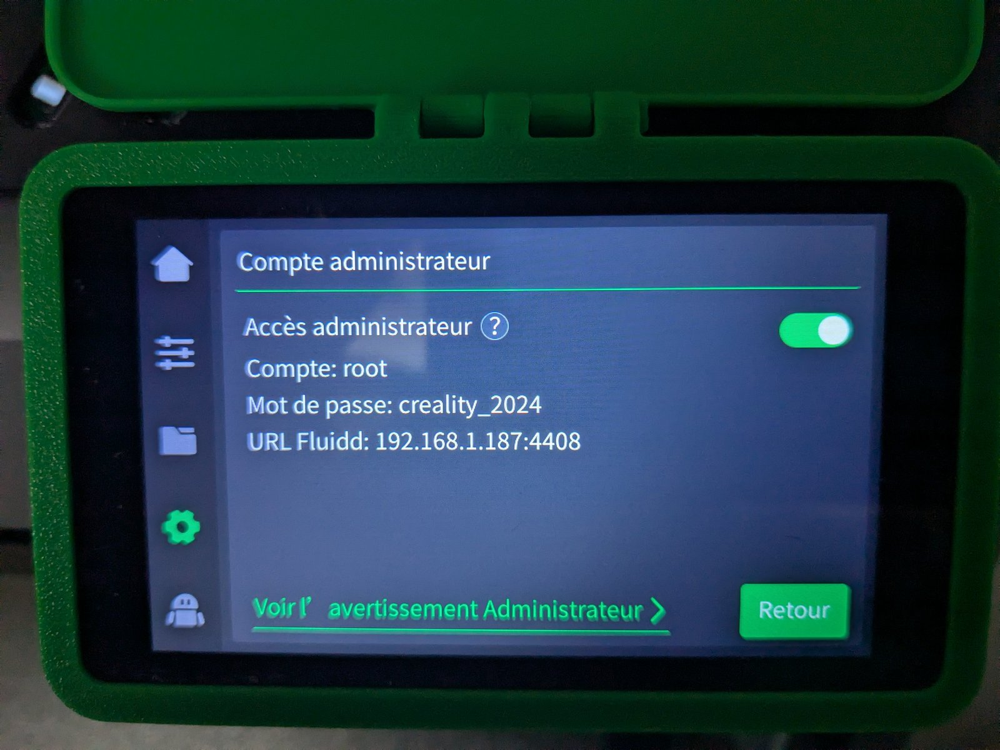
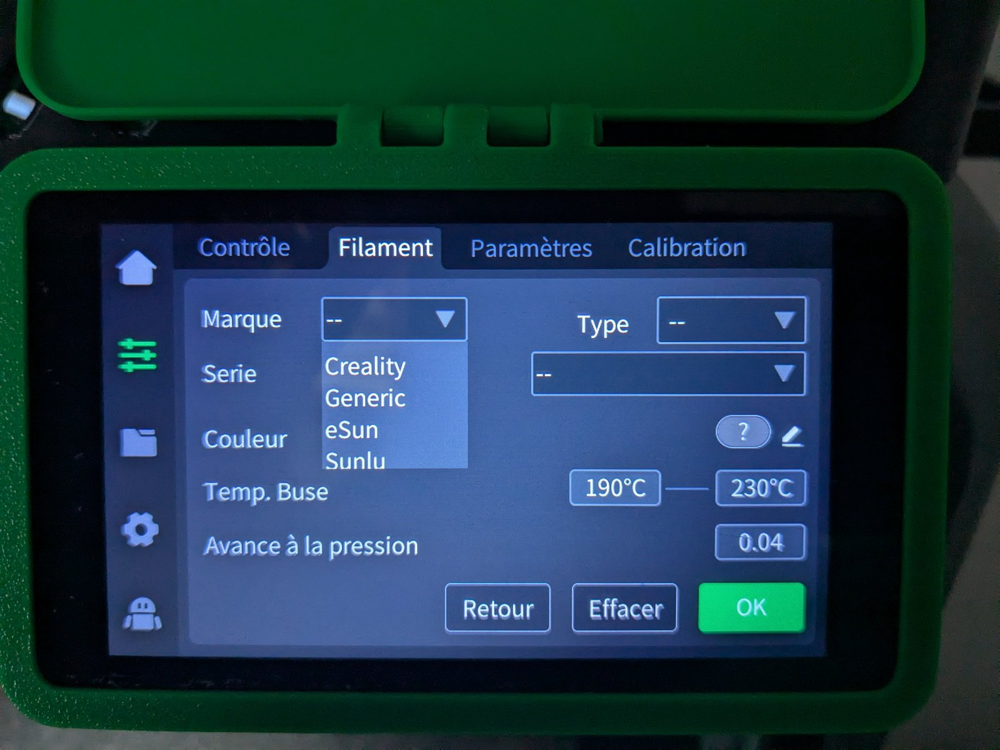
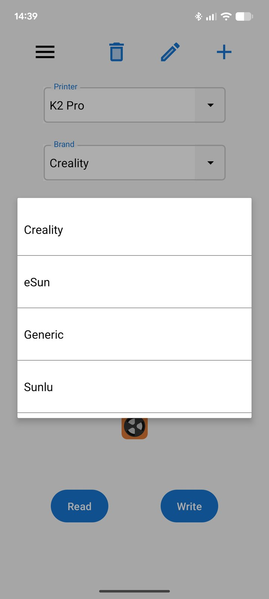
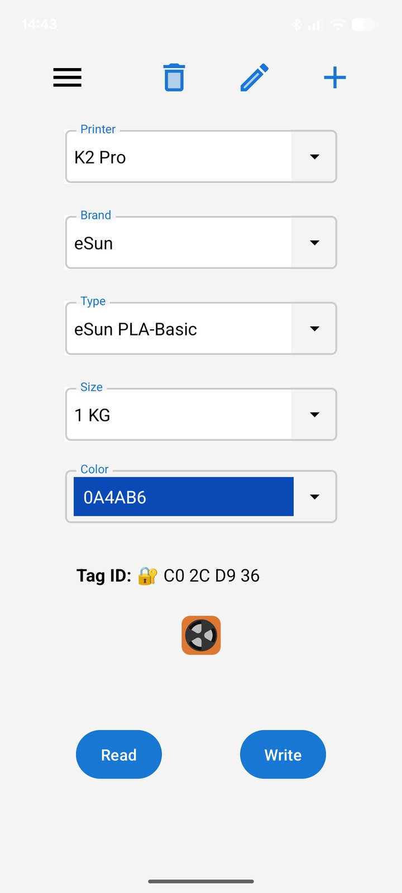
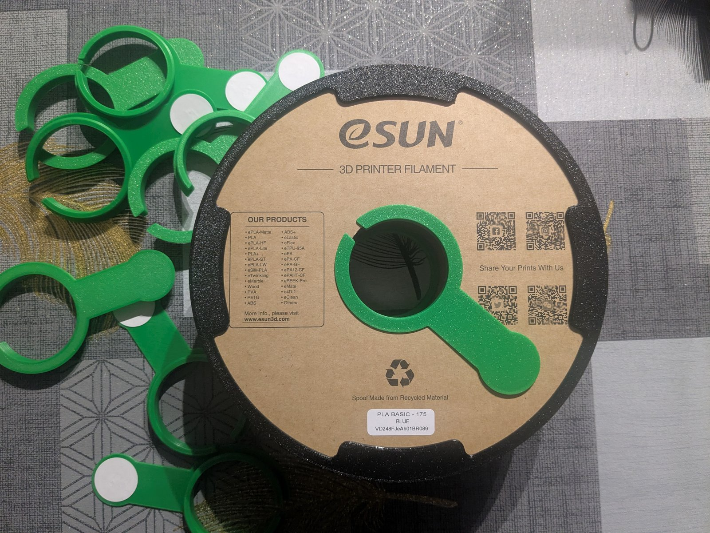
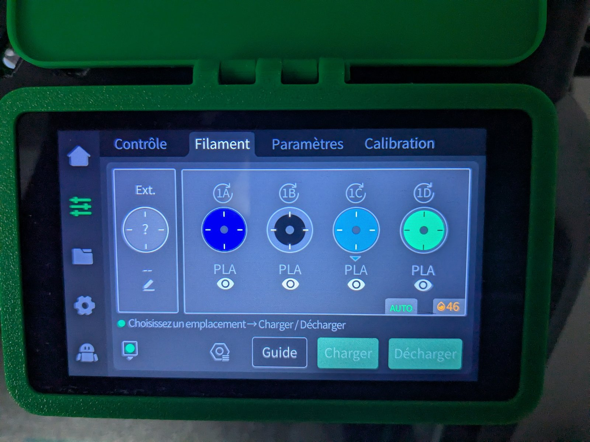
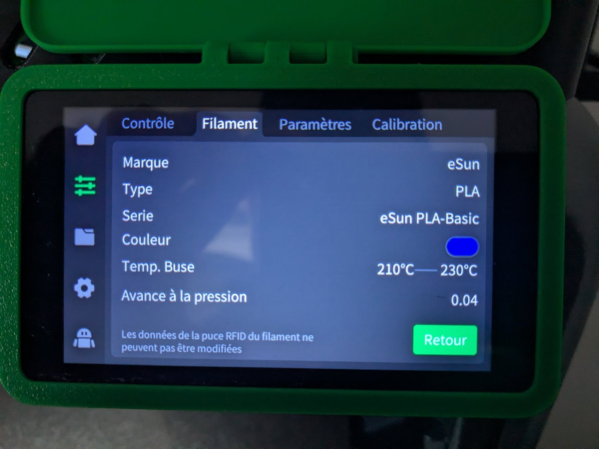

# 🧵 Creality K2 Pro / CFS: custom RFID for any spool (+ optional Spoolman / Home Assistant sync)

[Version française](README.fr.md)

Make **any third-party spool** (eSun, Sunlu, Extrudr...) fully compatible with the **CFS (Creality Filament System)** of the K2 Pro using RFID, with your filaments listed **by brand** in the printer menu. As an **optional bonus**, keep **Spoolman** automatically in sync through Home Assistant.

> **Disclaimer.** Community project, not affiliated with Creality. The RFID part requires **root access** to the printer and edits an internal file: it may void your warranty, and a mistake can break your filament menu. Always back up the original file first. Use at your own risk.

| | What it does | Needs |
|---|---|---|
| **Part 1: RFID tags** (main guide) | Third-party spools recognized by the CFS, grouped by brand | Root access, NFC phone, RFID tags |
| **Part 2: Spoolman / Home Assistant sync** (optional) | Tracks usage and auto-assigns the right Spoolman spool to the CFS slot | Home Assistant, Spoolman, SpoolmanSync. **No root.** |

---

## Part 1: RFID tags for any spool

### What you need
- **Printer:** Creality K2 Pro with CFS, **root access (SSH)**
- **Slicer:** Creality Print
- **Tags:** M1 Classic 1K NFC tags (13.56 MHz, 4-byte UID)
- **Phone:** Android with NFC, app **CFS RFID** ([Google Play](https://play.google.com/store/apps/details?id=dngsoftware.spoolid))
- **Computer:** to connect over SSH and copy files (SCP/SFTP)

### Why the printer catalog must be edited
By default, the K2 Pro does not recognize third-party RFID tags and lists every non-Creality spool as **Generic**. The CFS identifies a filament through an ID stored on the tag, looked up in the printer's own catalog. To get your brands (eSun, Sunlu...) in the menu and on the tags, you add them to that catalog.

### Step 1: create and export your filaments
1. In Creality Print, create your custom filaments (brand, type, temperatures...).
2. Export your filament presets (one `.json` per filament).

### Step 2: edit the printer catalog
1. **Enable root access** on the printer screen: *Settings* > *General* > *Administrator account* > *Administrator access*. The printer shows a warning about the risks of root mode; read it carefully and accept, and it then displays the username (`root`) and the password (`creality_2024`), which are the same on every printer. 
   Then connect over SSH with that username and password. Since they are the same for everyone, never expose the printer to the Internet while root mode is enabled.
2. **Back up** the catalog, located at `/mnt/UDISK/creality/userdata/box/material_database.json`.
3. Edit the file (see [Catalog structure](#catalog-structure)) to add your filaments under their own brand, by hand, with the [HTML tool](tools/add_filament.html) or with the [Python script](tools/add_filament.py).
4. Update the header: `result.count` and `result.version` (see [Versioning](#versioning)).
5. Copy the file back to the same path via SCP/SFTP, then restart the services or the printer.
6. Check the printer's filament menu: your filaments should appear grouped by brand .

### Step 3: sync the catalog into the CFS RFID app
1. Make sure the phone is on the same local network as the printer.
2. Open **CFS RFID** and connect it to the printer (IP address).
3. **Download the database** from the printer into the app.
4. Your brands and filaments are now selectable .

### Step 4: write the tags
1. In the app, select the printer (*K2 Pro*), the brand, the type (the filament model), the spool size (e.g. *1 KG*) and the color.
2. Check that the type and the color match what you defined in the catalog.
3. Hold the M1 Classic 1K tag against the back of the phone to write it. 

### Step 5: attach the tag to the spool


- **Creality spools (reuse):** reprogram the original tag directly.
- **Reusable third-party spools:** stick a tag on **each flank** of the spool, using a 3D-printed positioning jig so the tag lines up with the CFS reader ([positioning jig](3d-models/RDIF_Positioning_Tool/)).
- **Cardboard spools on the external spool holder:** place on one flank of the spool a simple holder that takes the tag ([RFID_Holder](3d-models/RFID_Holder/)).
- **Disposable / cardboard spools (55 mm diameter, eSun type):** use a clip-on support that holds the tag ([Support_RFID_55mm](3d-models/Support_RFID_55mm/)).

All models are described in [3d-models/](3d-models/).

### Step 6: load the spool into the CFS
Once the spool is loaded into the CFS, the printer recognizes it automatically.



### Catalog structure
`material_database.json` looks like this:
```
{ "code": 0, "msg": "ok", "reqId": "...",
  "result": { "version": "...", "count": N, "list": [ { "base": {...}, "kvParam": {...} }, ... ] } }
```
- `base` is what the menu and the app display: `id`, `brand`, `name`, `meterialType` (sic), `colors`, `rank`, `minTemp`, `maxTemp`, drying values...
- `kvParam` holds the printing parameters of the slicer preset (`filament_vendor`, `filament_type`, temperatures, fan, bed...).

When a slicer preset is synced, the printer adds it with `"brand": "Generic"` and **reuses the generic ID** (`00001` for PLA, `00003` for PETG), plus a `userMaterial` field pointing to the preset file. That is why several entries share the same ID. **Keep these entries.**

**Adding a filament under its own brand:** add a **new entry** (copy a generic entry of the same material, e.g. `Generic PLA`, then change):

| Field | Value |
|---|---|
| `base.id` | A unique ID outside the Creality range, e.g. `90001`, `90002`... |
| `base.brand` | The brand shown in the menu (`eSun`, `Sunlu`) |
| `base.name` | Readable name, e.g. `eSun PLA-Basic` |
| `base.meterialType` | `PLA`, `PETG`... |
| `base.minTemp` / `maxTemp` | From your slicer preset |
| `base.rank` | Sort order (we used `3000`) |
| `kvParam.filament_vendor` | Same brand |
| `kvParam` temperatures, fan, bed | From your slicer preset |

An example `base` block is in [`docs/example-entry-base.json`](docs/example-entry-base.json).

### Using the HTML tool (the easiest way)
Nothing to install: open [`tools/add_filament.html`](tools/add_filament.html) in your browser (double-click the file).

1. **Drop** your `material_database.json` (taken from the printer) into the first zone.
2. **Drop** your filament presets exported from Creality Print into the second zone (you can drop several at once).
3. Click **Add the filaments** (or *Preview only* to see what would be done).
4. Click **Download the new material_database.json**, then replace the file on the printer (step 5 of the procedure).

The page works **offline**: your files are not sent anywhere and your original file is never modified (keep a backup anyway). It applies exactly the same rules as the Python script below.

### Using the Python script (optional)
If you are comfortable with Python, you can use [`tools/add_filament.py`](tools/add_filament.py) (Python 3, no dependencies). **Run it on your computer, on a copy of the catalog taken from the printer**, then copy the result back.

```
python add_filament.py material_database.json eSun_PLA-Basic.json Sunlu_PETG-Basic.json
python add_filament.py material_database.json my_preset.json --dry-run
```

For each exported preset, the script:
1. finds the matching generic entry through the preset's `inherits` field;
2. copies it, then sets the `id` (next free id from `90001`), the brand (`filament_vendor`), a readable name, the `rank`, the min/max temperatures and the density;
3. overlays the preset values onto `kvParam` (only keys that already exist in the catalog; others are reported);
4. updates `result.count` and raises `result.version` by at least 1 on every change;
5. **saves a timestamped backup** of the original file before writing.

Useful options: `--dry-run` (writes nothing), `--out file.json` (writes elsewhere), `--id` (forced id, single preset only), `--replace` (replaces an existing entry with the same brand and name). A filament already in the catalog is skipped unless you pass `--replace`.

*Check:* applied to our original catalog with our five presets, the script reproduces our five entries. Three are strictly identical; for the two PETG entries, the only difference is that the script aligns the `base` density with the `kvParam` one (1.27 instead of 1.24).

### Versioning
- `result.count` must equal the new number of entries.
- `result.version` must be set to a **very large number** so that your catalog is never considered older than another version and overwritten. We used `9876543210`. **The value must be higher than the original one** (in our file the original looked like a timestamp, `1790760956`), so a small number such as `999999` would do the opposite of what you want.
- **Change the version on every modification.** The CFS RFID app only downloads the catalog again when it sees a different version number. If you edit the file but keep the same version, the app keeps its old copy. The HTML tool and the Python script do this for you (+1 on every change).
- This is an observed practice, not documented by Creality.

### Pitfalls
- Keep a copy of every catalog version before editing.
- The CFS RFID app does not show your new filaments? Check that `result.version` really changed, then download the database again in the app.
- Make sure the JSON stays valid before copying it back.
- In our PETG examples, `density` in `base` (1.24) differs from `kvParam.filament_density` (1.27): keep them consistent in your own entries (the script does this automatically).

---

## Part 2 (optional): Spoolman / Home Assistant sync

Skip this part if you do not use Home Assistant or Spoolman. It needs **no root access** and builds on the tags from Part 1.

### What you need
Home Assistant with the following components (tested versions):

| Component | Tested version | Notes |
|---|---|---|
| [ha_creality_ws](https://github.com/3dg1luk43/ha_creality_ws) | 0.9.10 | Home Assistant integration for the printer |
| [Spoolman](https://github.com/Donkie/Spoolman) | 0.27.0 | Port 7912 by default |
| [SpoolmanSync](https://github.com/gibz104/SpoolmanSync) | 1.6.14 | Port 3000 by default |

### How it works
1. The integration exposes one sensor per CFS slot (`sensor.k2pro_creality_cfs_box_1_slot_1_filament`, ...) with attributes such as `vendor`, `type`, `color_hex`, `rfid`, `spool_key`, `selected`.
2. Two SpoolmanSync automations track the active slot and the filament length used (cm) and send it to SpoolmanSync.
3. A third automation **assigns the Spoolman spool to the slot** when a tag is read: it looks in Spoolman for non-archived spools with the **same vendor, material and color** as the tag. If several match, it picks the spool already started with the least filament left, otherwise the first one.

### Matching rule (important)
In Spoolman:
- the **vendor name** must equal the brand written on the tag (e.g. `eSun`), case-insensitive;
- the **material** must equal the filament type (e.g. `PLA`);
- the **color hex** must equal the color written on the tag (without `#`, case-insensitive).

### Installation
1. Install and configure Spoolman and SpoolmanSync, and add your printer in SpoolmanSync.
2. Add the blocks from [`homeassistant/configuration_spoolmansync.yaml`](homeassistant/configuration_spoolmansync.yaml) to your `configuration.yaml`, replacing `k2pro_creality` with your printer name and the placeholder IPs (`SPOOLMAN_IP`, `SPOOLMANSYNC_IP`) with yours.
3. Put your webhook token in `secrets.yaml` (see [`homeassistant/secrets.example.yaml`](homeassistant/secrets.example.yaml)). **Never commit your real token.**
4. Add the three automations from [`homeassistant/automations_spoolmansync.yaml`](homeassistant/automations_spoolmansync.yaml). In the last one, set `printer_ip` to your printer's IP address.
5. Restart Home Assistant.
6. **Test first:** `dry_run` is `true` by default, so the automation only sends a notification saying which spool it *would* assign. Insert a tagged spool, check the notification, then set `dry_run: false`.

### Good to know
- **Slot indexing:** SpoolmanSync counts slots from 0, so CFS slot 1 is index 0. The automation handles this (`slot_num - 1`).
- **External spool:** the tray key `cfs_external_filament` should be verified on your setup.
- If no spool matches, a persistent notification asks you to assign it manually in SpoolmanSync.

---

## Credits and license
This project builds on the work of others:
- the [CFS RFID](https://play.google.com/store/apps/details?id=dngsoftware.spoolid) app (dngsoftware) to write the tags;
- [SpoolmanSync](https://github.com/gibz104/SpoolmanSync), [Spoolman](https://github.com/Donkie/Spoolman) and [ha_creality_ws](https://github.com/3dg1luk43/ha_creality_ws) for the Home Assistant part.

**Licenses:** Home Assistant configuration and tools (`homeassistant/`, `tools/`) under the [MIT license](LICENSES/MIT.txt); 3D models and documentation (`3d-models/`, `docs/`) under [CC BY-SA 4.0](LICENSES/CC-BY-SA-4.0.txt). Details in [LICENSE](LICENSE).

See also [CONTRIBUTING.md](CONTRIBUTING.md).
