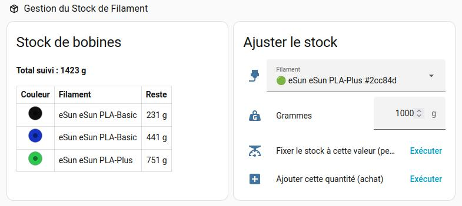

# Option B : stock de filament dans Home Assistant (sans Spoolman)

[English version](README.md) · [Retour au guide principal](../../README.fr.md)

Connais ton stock de filament restant avec Home Assistant seul : `imprimante → Home Assistant`, rien d'autre.

> **Choisis A ou B, pas les deux.** Cette option partage des assistants, des capteurs, un compteur et un identifiant d'automation avec l'[option A (Spoolman)](../spoolman/README.fr.md). N'installe que l'une des deux.

## Pourquoi cette option
La chaîne imprimante → SpoolmanSync (sur un NAS) → Home Assistant → Spoolman peut être complexe et sensible aux mises à jour, et Spoolman ne peut pas savoir laquelle de plusieurs bobines identiques est en service. Si ton besoin réel est de connaître ton stock restant, cette option est plus simple.

## Fonctionnement
- **Un compteur en grammes par référence de filament**, pas par bobine physique. La clé est le code matière lu sur la puce (attribut `rfid`) plus la couleur (`color_hex`). Pour une bobine sans puce, la clé se compose du matériau, du nom et de la couleur saisis sur l'écran de l'imprimante.
- **À chaque changement de slot et en fin d'impression**, l'automation relève la longueur de filament consommée et appelle un petit script Python (`stock_filament.py`, bibliothèque standard uniquement). Le script la convertit en grammes (filament 1,75 mm, densité par matériau ; ordre de grandeur : 1 m de PLA ≈ 3 g) et la retire du compteur.
- Cette automation réutilise la logique de suivi (changement de slot, fin d'impression, imprimante hors ligne) et les capteurs générés à l'origine pour SpoolmanSync. C'est pourquoi les entités gardent leur préfixe `spoolmansync_*` : elles correspondent à la configuration réellement testée.
- **Données :** `/config/stock/stock_filament.json`, avec une copie `.bak` du dernier état valide avant chaque écriture. Chaque opération est aussi journalisée dans `stock_filament_log.csv` (séparateur `;`, virgule décimale, ouvrable dans Excel).
- **`sensor.stock_filament`** (intégration `command_line`) expose le tout. Son état est le nombre de références ; **`-1` signifie que le fichier JSON est illisible**. Il est actualisé après chaque action et toutes les heures.

## Tableau de bord

- **Tableau « Stock filament » :** couleur, nom du filament, quantité restante. « ⚠️ stock à saisir » s'affiche tant que le poids réel n'a pas été renseigné.
- **Carte « Ajuster le stock » :** une liste déroulante alimentée automatiquement avec les filaments enregistrés (ceux dont le stock reste à saisir en premier), un champ « Grammes » et deux boutons : *Fixer le stock* (après une pesée) et *Ajouter au stock* (après un achat). Aucune saisie technique.
- Les assistants (liste déroulante et champ de grammes) sont déclarés dans `configuration.yaml`, une automation remplit la liste et deux scripts exécutent les boutons.

**À propos de l'affichage de la couleur.** Une pastille en HTML/CSS (``) ne s'affichait pas dans la carte Markdown, vraisemblablement parce que Home Assistant filtre les styles inline. La solution est la même que celle des cartes Mushroom des slots du CFS : une petite image SVG intégrée (`data:image/svg+xml`) colorée avec le code couleur, avec une pastille emoji en texte de secours. Dans la liste déroulante, qui ne peut pas contenir d'image, la couleur est symbolisée par la pastille emoji la plus proche (⚫ ⚪ 🔴 🟠 🟡 🟢 🔵 🟣 🟤 : 9 catégories seulement, ❔ si inconnue).

## Testé avec
Home Assistant OS 18.5 et Creality WebSocket Integration ([ha_creality_ws](https://github.com/3dg1luk43/ha_creality_ws)) 0.9.10, sur une K2 Pro avec CFS. Les chemins supposent `/config`, et le script est lancé par `shell_command` avec `python3`.

## Installation
1. Copie [`stock/stock_filament.py`](stock/stock_filament.py) dans `/config/stock/` (crée le dossier).
2. Ajoute à ton `configuration.yaml` les blocs de [`configuration_extrait.yaml`](configuration_extrait.yaml), en remplaçant `k2pro_creality` par le préfixe des entités de ton imprimante. Fusionne-les avec tes blocs `template:`, `input_number:` et `utility_meter:` existants ; `input_select:`, `shell_command:` et `command_line:` sont nouveaux.
3. Ajoute les deux automations de [`automations_extrait.yaml`](automations_extrait.yaml), les deux scripts de [`scripts_extrait.yaml`](scripts_extrait.yaml) (ou crée-les dans l'interface : Paramètres > Automatisations et scènes > Scripts > Modifier en YAML) et la section de tableau de bord de [`dashboard_extrait.yaml`](dashboard_extrait.yaml) (à coller dans la liste `sections:` d'une vue de type *Sections*, avec l'éditeur de configuration brut du tableau de bord).
4. Vérifie la configuration (Outils de développement > YAML), puis **redémarre** Home Assistant. Un simple rechargement ne suffit pas pour `shell_command`, `command_line` et les nouveaux assistants.
5. **Teste sans imprimer**, dans Outils de développement > Actions : lance `shell_command.stock_filament_debit` avec `key: test_ffffff`, `label: Test PLA #ffffff`, `material: PLA` et `length_cm: 1000` (≈ -30 g), puis `homeassistant.update_entity` sur `sensor.stock_filament`. La ligne doit apparaître dans le tableau.
6. **Supprime l'entrée de test.** Lance `shell_command.stock_filament_remove` avec `query: Test PLA #ffffff`, puis `homeassistant.update_entity` sur `sensor.stock_filament`. Si tu n'as pas encore saisi de vrai stock, tu peux aussi simplement supprimer `/config/stock/stock_filament.json` (l'historique reste dans le CSV). **Ne modifie pas le JSON à la main** : une virgule en trop le rend illisible.

## Utilisation
Une référence n'apparaît qu'à sa première consommation, avec un stock à 0 qui passe en négatif et la mention « stock à saisir ». Choisis le filament dans la liste, saisis le poids réel de la bobine et appuie sur *Fixer le stock*. Ensuite, chaque impression le fait baisser automatiquement. Appuie sur *Ajouter au stock* après l'achat d'une nouvelle bobine.

## Dépannage
- **Journaux « Command failed (with return code 1): python3 /config/stock/stock_filament.py dump » et « Empty reply found when expecting JSON data » :** `stock_filament.json` est invalide, typiquement après une modification manuelle (virgule en trop, accolade manquante). Corrige la syntaxe, restaure la copie `.bak`, ou supprime le fichier si tu n'as pas encore saisi ton stock (l'historique reste dans le CSV). Avec la version actuelle du script, le capteur affiche `-1` au lieu de produire une erreur, et les commandes d'écriture ne modifient rien.
- **La liste déroulante reste sur « aucun filament enregistre » :** aucune consommation n'a encore été enregistrée, ou le script n'est pas à jour (mets-le à jour avant l'automation).
- **Le tableau s'affiche sur une seule ligne :** utilise `content: |` et non `content: >` dans la carte Markdown, sinon les retours à la ligne du tableau disparaissent.
- **Les boutons de la carte ne font rien :** l'identifiant des scripts créés via l'interface dérive de leur nom. Vérifie-le dans Paramètres > Scripts et adapte-le dans la carte. Les fichiers fournis utilisent `script.stock_filament_fixer_le_stock` et `script.stock_filament_ajouter_au_stock`.

## Limites
- Le suivi est **par référence, pas par bobine** : on sait combien on en a en tout, pas quelle bobine est la plus vide.
- La précision dépend de la longueur de filament déclarée par l'imprimante : pèse une bobine de temps en temps pour recaler.
- Une bobine sans puce sur le support externe est identifiée par son matériau, son nom et sa couleur saisis à l'écran. Si tu les modifies d'une fois sur l'autre, cela crée une nouvelle référence.
- La couleur dans la liste déroulante n'est qu'une approximation en 9 catégories.

## Fichiers
| Fichier | Rôle |
|---|---|
| `configuration_extrait.yaml` | Assistants, compteur, capteurs, `shell_command`, `command_line` |
| `automations_extrait.yaml` | Débit du stock (changement de slot, fin d'impression, imprimante hors ligne) et mise à jour de la liste déroulante |
| `scripts_extrait.yaml` | Boutons *Fixer le stock* et *Ajouter au stock* |
| `dashboard_extrait.yaml` | Section de tableau de bord avec le tableau « Stock filament » et la carte « Ajuster le stock » |
| `stock/stock_filament.py` | Script du compteur (`debit`, `set`, `add`, `remove`, `dump`) |
