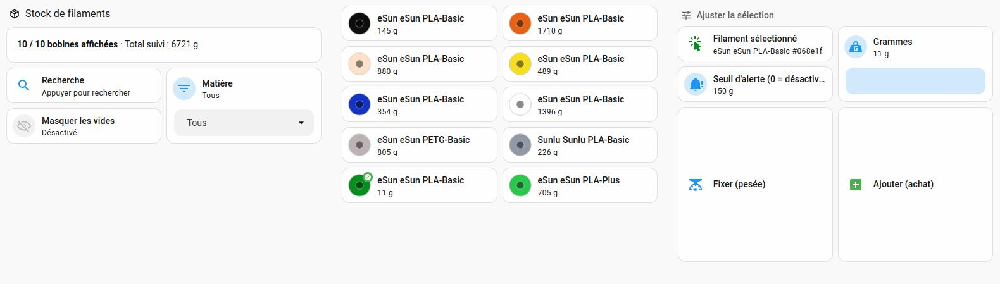

# Option B: filament stock in Home Assistant (no Spoolman)

[Version française](README.fr.md) · [Back to the main guide](../../README.md)

Know how much filament you have left with Home Assistant alone: `printer → Home Assistant`, nothing else.

> **Choose A or B, not both.** This option shares helpers, sensors, a utility meter and an automation id with [option A (Spoolman)](../spoolman/README.md). Install only one of them.

## Why this option
The chain printer → SpoolmanSync (on a NAS) → Home Assistant → Spoolman can be complex and sensitive to updates, and Spoolman cannot know which of several identical spools is in use. If what you really want is to know your remaining stock, this option is simpler.

## How it works
- **One counter in grams per filament reference**, not per physical spool. The key is the material code read on the tag (attribute `rfid`) plus the color (`color_hex`). For a spool without a tag, the key is built from the material, name and color entered on the printer screen.
- **On every slot change and at the end of a print**, the automation reads the length of filament used and calls a small Python script (`stock_filament.py`, standard library only). The script converts it to grams (1.75 mm filament, density per material; rule of thumb: 1 m of PLA ≈ 3 g) and subtracts it from the counter.
- **Computed by delta, not by a utility meter.** The `used_material_length` sensor is cumulative over a print. The automation keeps a reference (`input_number.k2pro_creality_last_used_length`) and only debits the difference. At the start of a print, the reference is reset to 0.
- This automation reuses the tracking logic (slot change, end of print, printer offline) and the `Active Tray` sensor originally generated for SpoolmanSync. That is why the entity names keep their `spoolmansync_*` prefix: they match the configuration that was actually tested. **Only the `Active Tray` sensor is required**; the `Filament Usage` sensor and the `utility_meter` are specific to option A and must not be installed.
- **Data:** `/config/stock/stock_filament.json`, with a `.bak` copy of the last valid state before every write. Every operation is also logged in `stock_filament_log.csv` (`;` separator, decimal comma, opens in Excel).
- **`sensor.stock_filament`** (`command_line` integration) exposes everything. Its state is the number of references; **`-1` means the JSON file is unreadable**. It is refreshed after each action and every hour.

## Dashboard

- **Tile grid:** one card per filament, with its real color, name and remaining weight. "⚠️ à saisir" is shown until the real weight is entered. Recently used filaments come first.
- **Search and filters:** text search field, material filter (PLA, PETG…), and a toggle to hide empty spools.
- **Selection and adjustment:** click a tile to select it (green badge), then enter the weight and press *Fixer (pesée)* or *Ajouter (achat)*. No technical input needed.
- **Low-stock threshold:** a dedicated field (`input_number.stock_filament_seuil_alerte`) triggers a persistent notification when a reference drops below it. 0 = alerts disabled.
- The helpers (selection, search, filter, grams, threshold) are declared in `configuration.yaml`, one automation handles the alert and two scripts run the buttons.
- The dashboard texts are in French; edit them freely in the YAML.

**About the color display.** A pill made with HTML/CSS (``) did not show in the Markdown card, probably because Home Assistant filters inline styles. The solution is the same as the Mushroom cards of the CFS slots: a small embedded SVG image (`data:image/svg+xml`) filled with the color code. The emoji dot is no longer used in the dashboard, but remains available in the `dot` / `option` attributes of `sensor.stock_filament` for other uses.

## Tested with
Home Assistant OS 18.5 and Creality WebSocket Integration ([ha_creality_ws](https://github.com/3dg1luk43/ha_creality_ws)) 0.9.10, on a K2 Pro with CFS. Paths assume `/config`, and the script runs through `shell_command` with `python3`. Required cards: `auto-entities` and `mushroom`.

## Installation
1. Copy [`stock/stock_filament.py`](stock/stock_filament.py) to `/config/stock/` (create the folder).
2. Add the blocks of [`configuration_extrait.yaml`](configuration_extrait.yaml) to your `configuration.yaml`, replacing `k2pro_creality` with the entity prefix of your printer. Merge them with your existing `template:`, `input_number:` and `utility_meter:` blocks; `input_text:`, `input_select:`, `input_boolean:`, `shell_command:` and `command_line:` are new. The `utility_meter` and the `Filament Usage` sensor are legacy from SpoolmanSync: they are not read by the option B automation, but are kept for compatibility. You can remove them if you never installed option A.
3. Add the **two** automations of [`automations_extrait.yaml`](automations_extrait.yaml) (debit and low-stock alert), the two scripts of [`scripts_extrait.yaml`](scripts_extrait.yaml) (or create them in the interface: Settings > Automations & scenes > Scripts > Edit in YAML) and the dashboard view of [`dashboard_extrait.yaml`](dashboard_extrait.yaml) (paste it into the `views:` list of your dashboard, using the raw configuration editor).
4. Check the configuration (Developer tools > YAML), then **restart** Home Assistant. A simple reload is not enough for `shell_command`, `command_line` and the new helpers.
5. **Test without printing**, in Developer tools > Actions: run `shell_command.stock_filament_debit` with `key: test_ffffff`, `label: Test PLA #ffffff`, `material: PLA` and `length_cm: 1000` (≈ -30 g), then `homeassistant.update_entity` on `sensor.stock_filament`. The tile must appear in the grid.
6. **Remove the test entry.** Run `shell_command.stock_filament_remove` with `query: Test PLA #ffffff`, then `homeassistant.update_entity` on `sensor.stock_filament`. If you have not entered any real stock yet, you can also simply delete `/config/stock/stock_filament.json` (the history stays in the CSV). **Do not edit the JSON by hand**: a stray comma makes it unreadable.

## Usage
A reference only appears at its first consumption, with a stock of 0 that goes negative and the note "⚠️ à saisir". Click the tile, enter the real weight of the spool and press *Fixer (pesée)*. After that, every print lowers it automatically. Press *Ajouter (achat)* after buying a new spool.

> **No initial value on the "Grammes" field.** It starts at 0 and nothing is validated until you enter a weight. This is intentional: it avoids suggesting a fictitious 1000 g stock before the first weighing.

## Troubleshooting
- **Logs "Command failed (with return code 1): python3 /config/stock/stock_filament.py dump" and "Empty reply found when expecting JSON data":** `stock_filament.json` is invalid, typically after a manual edit (extra comma, missing brace). Fix the syntax, restore the `.bak` copy, or delete the file if you have not entered your stock yet (the history stays in the CSV). With the current script, the sensor shows `-1` instead of failing, and the write commands change nothing.
- **The tile grid stays empty:** no consumption has been recorded yet, or the script is not up to date (update it before the automation).
- **The *Fixer* / *Ajouter* buttons do nothing:** no tile is selected. Click a tile first (green badge), then enter the weight and press the button. Also check the id of scripts created in the interface (Settings > Scripts): the provided files use `script.stock_filament_fixer_le_stock` and `script.stock_filament_ajouter_au_stock`.
- **The low-stock alert does not fire:** check that the threshold (`input_number.stock_filament_seuil_alerte`) is greater than 0, and that the filament has an entered stock (`tracked: true`). The threshold applies to references whose stock has already been weighed.

## Limits
- Tracking is **per reference, not per spool**: you know how much you have in total, not which spool is emptiest.
- Accuracy depends on the filament length the printer reports: weigh a spool from time to time to recalibrate.
- A spool without a tag on the external holder is identified by the material, name and color entered on the screen. If you change them from one time to the next, a new reference is created.
- The inline JSON generated by `auto-entities` may break if a filament name contains an apostrophe or a double quote. Avoid these characters in spool names.
- The low-stock alert uses persistent notifications. To also receive a notification on your phone, uncomment the `notify.mobile_app_*` block in `automations_extrait.yaml`.

## Files
| File | Role |
|---|---|
| `configuration_extrait.yaml` | Helpers, `Active Tray` sensor, `shell_command`, `command_line` |
| `automations_extrait.yaml` | Stock debit (slot change, end of print, printer offline) and low-stock alert |
| `scripts_extrait.yaml` | *Fixer le stock* and *Ajouter au stock* buttons |
| `dashboard_extrait.yaml` | `Filaments` view with the tile grid and the adjustment card |
| `stock/stock_filament.py` | Counter script (`debit`, `set`, `add`, `remove`, `dump`) |

See the [CHANGELOG](../../CHANGELOG.md) for the change history.
